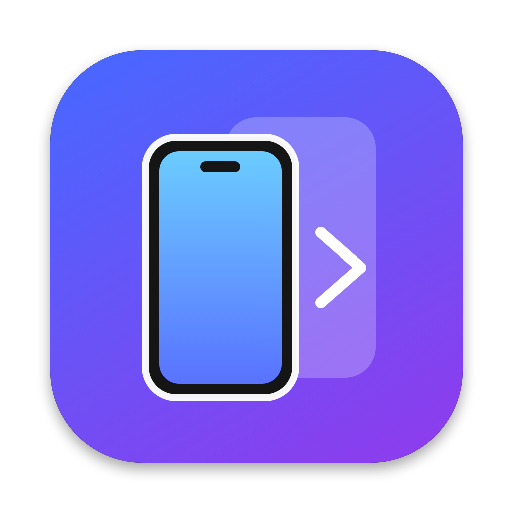
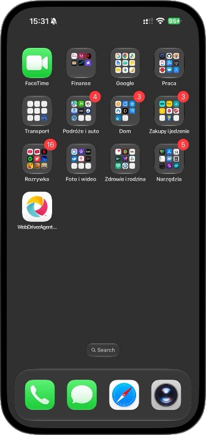
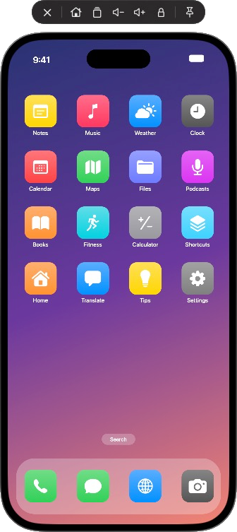
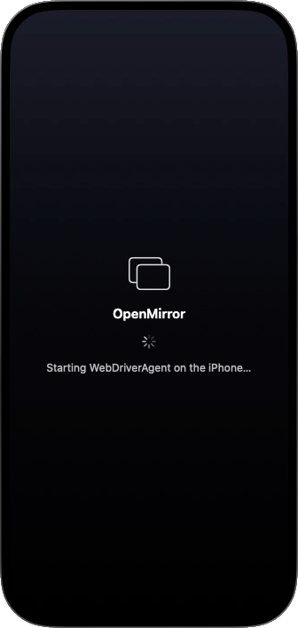
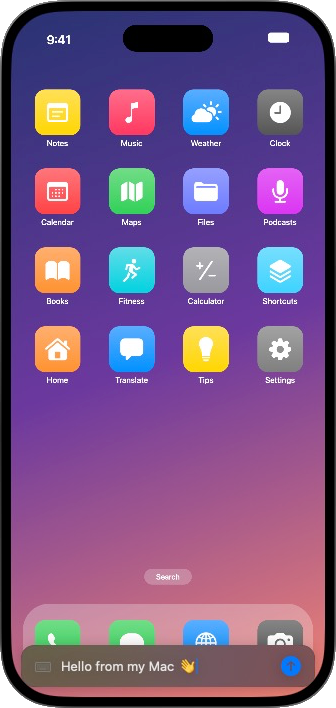

<p align="center">
  
</p>

<h1 align="center">OpenMirror</h1>

<p align="center">
  <b>See and control your iPhone from your Mac — an open-source alternative to iPhone Mirroring that works in the EU.</b><br>
  USB or Wi-Fi · no jailbreak · no VPN or region change · no cloud
</p>

<p align="center">
  
  &nbsp;&nbsp;
  
</p>

---

## Why

Apple's **iPhone Mirroring** is not available in the European Union. OpenMirror gives you the same idea —
your iPhone in a window on your Mac that you can click, swipe and type into — using only tools Apple ships
for developers (Xcode and XCTest). Everything runs locally – over a USB cable or your home Wi-Fi.

## Features

- 📱 **Floating phone window** – borderless, with a device frame; drag it by the bezel
- 🖱️ **Click = tap, drag = swipe, click-and-hold = long press** (pause before dragging to move icons)
- 🖐️ **Trackpad scrolling** becomes swipes on the phone
- ⌨️ **Typing** – start typing and a compose field appears; press Return to send the text to the iPhone
  (Polish and other accented characters work, ⌘V pastes)
- 🏠 **Control bar on hover** – Home, App Switcher, Volume, Lock, **Keep on Top** 📌
- 📶 **USB or Wi-Fi** – uses the cable when connected, otherwise the iPhone paired over Wi-Fi
- 🔌 **Automatic setup** – finds the iPhone, detects your signing team, downloads and builds the helper for you
- 🔒 **Local only** – no servers, no accounts, no telemetry

## Requirements

| | |
|---|---|
| Mac | macOS 14 Sonoma or newer |
| Xcode | Installed and opened once (`xcode-select` pointing at it) |
| Apple ID | Signed in to Xcode → Settings → Accounts. **A free Apple ID works** (the helper then expires after 7 days and is rebuilt automatically); a paid developer account lasts a year |
| iPhone | Connected by **USB cable** (or on the same Wi-Fi – see below), unlocked, "Trust This Computer" accepted, **Developer Mode** on (Settings → Privacy & Security → Developer Mode) |

## Download

**[⬇︎ Download OpenMirror for macOS](https://github.com/paweb88/OpenMirror/releases/latest)** – signed with Developer ID and notarized by Apple.

Open the `.dmg`, drag **OpenMirror** to **Applications** and start it. You still need **Xcode** installed
(OpenMirror uses it to sign and launch the helper on your iPhone with your own Apple ID).

## Build from source

```bash
brew install xcodegen
git clone https://github.com/paweb88/OpenMirror.git
cd OpenMirror
xcodegen
open OpenMirror.xcodeproj   # then ⌘R
```

Or build from the command line:

```bash
xcodebuild -project OpenMirror.xcodeproj -scheme OpenMirror -configuration Release -derivedDataPath build
open build/Build/Products/Release/OpenMirror.app
```

## First run

1. Connect the iPhone with a cable and unlock it.
2. Start OpenMirror. It finds the phone and your signing team (if you have several, pick one).
3. **First launch only:** OpenMirror downloads [WebDriverAgent](https://github.com/appium/WebDriverAgent)
   and builds it for your iPhone, signed with your team. This takes 1–2 minutes.
4. If the iPhone asks, trust the developer: **Settings → General → VPN & Device Management → your Apple ID → Trust**.
5. The phone appears on your Mac. 🎉

<p align="center">
  
  &nbsp;&nbsp;
  
</p>

### Wi-Fi

Connect the iPhone by cable once, open **Finder → your iPhone → General** and tick
**"Show this iPhone when on Wi-Fi"**. From then on OpenMirror also finds the phone over the local network
(same Wi-Fi as the Mac). A cable is preferred automatically when both are available.

## Using it

| On the Mac | On the iPhone |
|---|---|
| Click | Tap |
| Click and hold | Long press (context menus) |
| Drag | Swipe / scroll |
| Pause, then drag | Long press and move (e.g. rearrange icons) |
| Two-finger scroll on trackpad | Swipe |
| Type | Compose field → **Return** sends the text |
| Return / Backspace (no compose field open) | Return / delete on the phone |
| ⌘V | Paste the Mac clipboard as text |
| ⇧⌘H | Home |
| ⇧⌘A | App Switcher |
| ⇧⌘T | Keep window on top |
| ⌘R | Reconnect |

Hover over the window to show the control bar. Drag the black bezel to move the window.

## How it works

```
┌──────────── Mac ─────────────┐   USB or Wi-Fi (usbmuxd)    ┌──────── iPhone ────────┐
│ OpenMirror.app               │                             │ WebDriverAgent         │
│  • MJPEG viewer  ◀───────────┼──── screen stream :9100 ────┤  (XCTest UI runner,   │
│  • gestures/text ────────────┼──── REST commands :8100 ───▶│   signed by your team) │
│  • usbmux tunnel (Swift)     │                             │                        │
│  • xcodebuild launcher       │                             │                        │
└──────────────────────────────┘                             └────────────────────────┘
```

- **WebDriverAgent** (from the Appium project) is Apple-sanctioned UI-test tooling. It can tap, swipe and type
  anywhere on the phone and serves the screen as an MJPEG stream.
- OpenMirror launches it with `xcodebuild test-without-building` and talks to it through its own
  **usbmuxd tunnel written in Swift** – the same channel Finder and Xcode use, for both cable and Wi-Fi. No Python, no extra daemons.
- All app state lives in `~/Library/Application Support/OpenMirror` (WebDriverAgent sources, build, logs).

## Known limitations

- **"Automation Running"** is shown on the iPhone while mirroring – iOS displays it for every XCTest session.
- **Frame rate:** ~25–30 fps (MJPEG, 50 % scale). Fine for using apps, not for games.
- **Typing** is sent in bursts: iOS treats injected text like a hardware keyboard and briefly hides the on-screen
  keyboard, so text is composed on the Mac and sent at once.
- The iPhone must be **unlocked** to start; OpenMirror never handles your passcode.
- **No audio.**
- Over Wi-Fi smoothness depends on your network; the cable is the most stable.

## Roadmap

- [ ] 60 fps video via the iOS screen-capture device (the path QuickTime uses), keeping WebDriverAgent for input
- [x] Signed, notarized release builds
- [ ] Drag & drop files / photos to the iPhone

## Troubleshooting

| Problem | Fix |
|---|---|
| "No iPhone found" | Use a data cable, unlock the phone, tap **Trust** |
| "Xcode has no account for this team" | Xcode → Settings → Accounts → add your Apple ID |
| "Turn on Developer Mode" | Settings → Privacy & Security → Developer Mode → restart the phone |
| "Trust the developer" | Settings → General → VPN & Device Management |
| Stuck on "Unlock your iPhone" | Unlock it – mirroring starts automatically |
| Anything else | Click **Show Log** or open `~/Library/Application Support/OpenMirror/wda.log` |

## Development

```bash
xcodegen && xcodebuild test -project OpenMirror.xcodeproj -scheme OpenMirror -destination 'platform=macOS'
swift scripts/make-icon.swift Sources/Assets.xcassets/AppIcon.appiconset   # regenerate the icon
```

**Signed release** (Developer ID certificate + `xcrun notarytool store-credentials openmirror-notary …` once):

```bash
scripts/release.sh <TEAM_ID>   # → build/release/OpenMirror-<version>.dmg, signed, notarized and stapled
```

**Screenshots without personal data** – demo mode shows a generated screen instead of your phone:

```bash
swift scripts/make-demo-screen.swift docs/demo-screen.png
open OpenMirror.app --args --demo-screen "$PWD/docs/demo-screen.png" --show-controls
open OpenMirror.app --args --demo-screen "$PWD/docs/demo-screen.png" --demo-compose "Hello from my Mac 👋"
open OpenMirror.app --args --demo-connecting
swift scripts/transparent-shot.swift capture.jpg docs/screenshot.png 170   # transparent backdrop
```

| Path | What |
|---|---|
| `Sources/Core/Usbmux.swift` | usbmuxd client (list devices, connect to a device port) |
| `Sources/Core/PortForwarder.swift` | localhost → iPhone TCP tunnel |
| `Sources/Core/WDARunner.swift` | download, build and launch WebDriverAgent |
| `Sources/Core/WDAClient.swift` | WebDriverAgent REST client |
| `Sources/Core/MJPEGStream.swift` | MJPEG stream parser |
| `Sources/Core/GestureMapper.swift` | mouse / trackpad / keys → phone gestures |
| `Sources/UI/` | SwiftUI window, device frame, control bar, compose field |

## Credits & legal

- Built on [WebDriverAgent](https://github.com/appium/WebDriverAgent) (BSD 3-Clause, © Facebook / Appium contributors),
  downloaded at first run, not redistributed here.
- OpenMirror is **not affiliated with or endorsed by Apple**. iPhone, Mac, Xcode and iPhone Mirroring are trademarks of Apple Inc.
- Released under the [MIT License](LICENSE).
